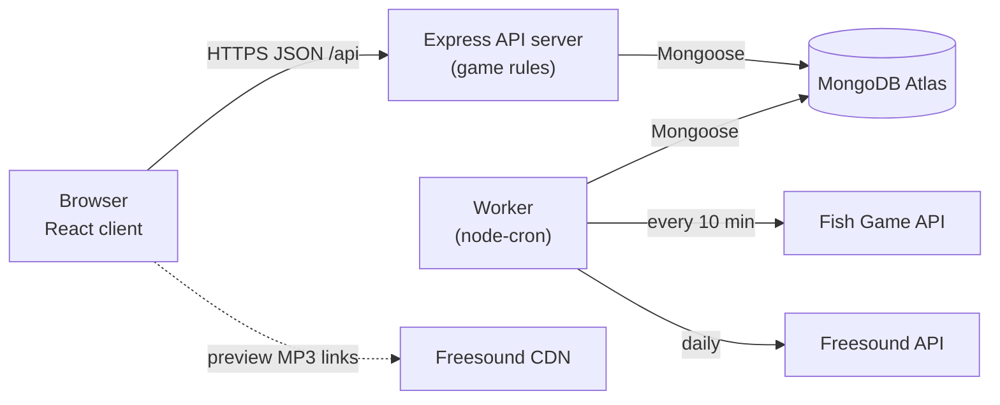

# Riverbound architecture

- **Low coupling:** the browser only knows our API. Only the worker knows the external APIs, and only inside `worker/src/providers/`.
- **High cohesion:** each service file does one job (`camp.service.ts`, `feeding.service.ts` and so on). The pure rules live in `shared/`.
- **Distributed:** server and worker are separate programs. They only share the database. If the worker stops, the game keeps working with saved content.
- **Server-authoritative:** the server decides coins, fish, hearts and rewards. The browser only shows them.
- **Exactly once:** every reward request has an `Idempotency-Key`. `server/src/services/action.service.ts` runs the change and saves the result in one MongoDB transaction.
- **Virtual identity:** passwords are hashed with scrypt. Sessions are random tokens in an HttpOnly cookie, and only the token hash is stored.
